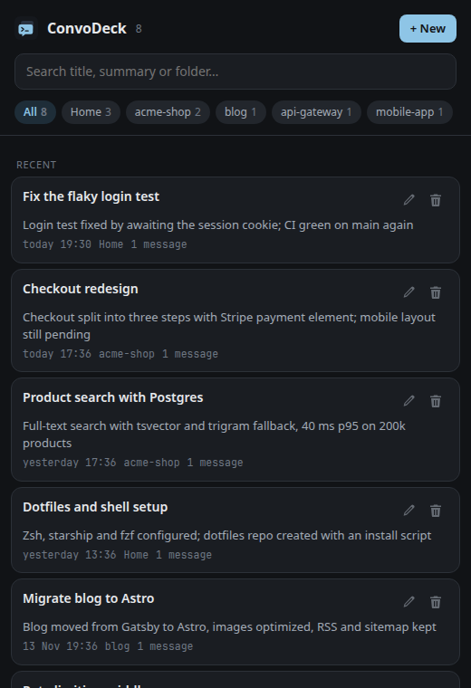
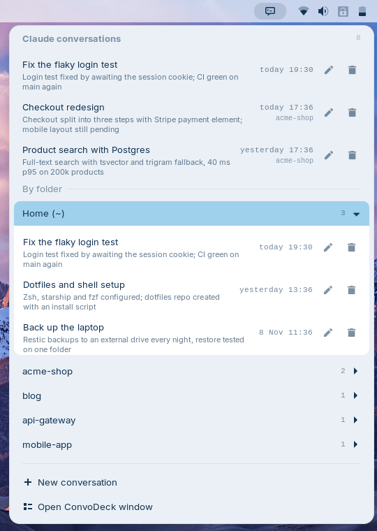

<p align="center">
  
</p>

<h1 align="center">ConvoDeck</h1>

<p align="center">
  A launcher for your <b>Claude Code</b> conversations — find any past session, see what it was about,
  and reopen it in a terminal with one click.<br>
  Linux (any distro) · Windows · macOS · English / Español
</p>

<p align="center">
  <a href="https://github.com/JotnarDev/convodeck/actions/workflows/test.yml"></a>
  
  
</p>

<p align="center">
  
  &nbsp;
  
</p>

> [Leer en español ↓](#español)

Claude Code saves every conversation, but `claude --resume` only shows a long list of first messages,
and only for the folder you are in. ConvoDeck gives every conversation a **title**, a **≤20-word summary**
and its **last-used date**, across all your folders, and lets you **resume**, **rename**, **hide** or
**delete** it.

It comes as a **Claude Code skill** (ask Claude in plain language) plus a small **desktop app**:

| | |
|---|---|
| **Window** | Search, folder filters, one click to resume in a new terminal, inline rename and delete. Opens as an app window (Edge, Chrome, Chromium, Brave…) from your app menu / Start Menu. |
| **GNOME top-bar menu** | Optional, GNOME 45+. Three most recent conversations, a submenu per folder, native rename/delete dialogs. |
| **Skill** | "What did we do in the chat about the checkout?", "reopen the Postgres conversation", "delete my old test chats", "give me a widget for my conversations". |
| **CLI** | `convodeck list`, `open`, `rename`, `summarize`, `delete`… for scripts and terminals. |

Summaries for new conversations are written in the background by **Claude Haiku** once a conversation
has been idle for 15 minutes (uses a little of your Claude usage; can be turned off).

## Install

### As a Claude Code plugin (recommended)

```text
/plugin marketplace add JotnarDev/convodeck
/plugin install convodeck@convodeck
```

Then just ask: *"install ConvoDeck so I have a launcher for my conversations"*. Claude checks your system
(`doctor`), installs the window shortcut and, on GNOME, the top-bar menu.

### Just the skill

Copy `skills/convodeck/` to `~/.claude/skills/convodeck/` (Windows: `%USERPROFILE%\.claude\skills\convodeck\`).

### Without Claude

```bash
git clone https://github.com/JotnarDev/convodeck
python3 convodeck/skills/convodeck/scripts/convodeck.py install      # Windows: py -3 ...
```

| | Creates |
|---|---|
| Linux | `~/.local/bin/convodeck`, app-menu entry *ConvoDeck*, GNOME menu on GNOME 45+ (log out/in once) |
| Windows | `%LOCALAPPDATA%\convodeck\` with `convodeck.cmd`, Start Menu shortcut *ConvoDeck* |
| macOS | `~/.local/bin/convodeck` — run `convodeck ui` (experimental) |

Uninstall with `convodeck uninstall` (your titles and summaries are kept).

**Requirements:** Python 3.9+ (standard library only — nothing to `pip install`) and Claude Code.
On Windows, `winget install Python.Python.3.12` if you don't have Python.

## Command line

```text
convodeck list [--limit N] [--search TEXT] [--json] [--hidden]
convodeck show ID            details + condensed transcript
convodeck open ID            resume in a new terminal
convodeck new [DIR]          new conversation in a terminal
convodeck rename ID [TITLE]  empty title = back to automatic
convodeck summary ID TEXT    set the summary yourself
convodeck summarize [--all] [--id ID]
convodeck delete ID --yes    moves it to the trash / Recycle Bin
convodeck hide ID | unhide ID
convodeck ui | install | uninstall | doctor
```

IDs can be shortened to any unique prefix (4+ characters).

## Settings

`settings.json` next to your data (`~/.config/convodeck/`, `%APPDATA%\convodeck\`,
`~/Library/Application Support/convodeck/`):

```json
{ "lang": "es", "terminal": "kitty", "browser": "/usr/bin/chromium", "auto_summaries": false }
```

Environment variables: `CONVODECK_LANG`, `CONVODECK_TERMINAL`, `CLAUDE_CONFIG_DIR`.

**Terminals** (auto-detected, desktop's own first): gnome-terminal, ptyxis, konsole, xfce4-terminal,
mate-terminal, tilix, terminator, lxterminal, qterminal, kitty, alacritty, wezterm, foot, ghostty, kgx,
xterm, x-terminal-emulator · Windows Terminal or the classic console · Terminal.app.

## Privacy and safety

- Everything stays on your machine. ConvoDeck only reads `~/.claude/projects` and writes its own
  `data.json`; the only network traffic is the optional `claude -p` call that writes summaries.
- Session files are never modified. **Delete** moves them to the system trash, so they can be restored.
- The window's local server listens on `127.0.0.1` only, requires a random per-launch token, checks
  `Host`/`Origin`, and shuts itself down a few minutes after the window closes.

## Development

```bash
python3 tools/demo.py /tmp/convodeck-demo        # fake data for screenshots
python3 tools/smoke_test.py                       # end-to-end test (also runs in CI on Linux, Windows, macOS)
```

---

## Español

ConvoDeck es un lanzador para tus conversaciones de **Claude Code**: cada conversación tiene **título**,
un **resumen de máximo 20 palabras** y la **fecha en que la usaste por última vez**, y puedes **retomarla**
en una terminal con un clic, **renombrarla**, **ocultarla** o **eliminarla** (va a la papelera).

- **Ventana**: búsqueda, filtros por carpeta, retomar, renombrar y eliminar. Se abre como app desde el
  menú de aplicaciones o el menú Inicio.
- **Menú en la barra de GNOME** (opcional, GNOME 45+): las 3 más recientes y un submenú por carpeta.
- **Skill**: pídeselo a Claude con tus palabras — *"¿qué hicimos en la conversación del checkout?"*,
  *"retoma la conversación de Postgres"*, *"borra mis chats viejos de pruebas"*, *"hazme un widget con mis conversaciones"*.
- **Resúmenes automáticos** con Claude Haiku cuando una conversación lleva 15 minutos sin usarse
  (gasta un poco de tu uso de Claude; se puede desactivar con `"auto_summaries": false`).

### Instalación

En Claude Code:

```text
/plugin marketplace add JotnarDev/convodeck
/plugin install convodeck@convodeck
```

y luego: *"instala ConvoDeck para tener un lanzador de mis conversaciones"*.

Sin Claude: `python3 skills/convodeck/scripts/convodeck.py install` (en Windows `py -3 ...`).
El idioma sigue al del sistema; para forzarlo, `"lang": "es"` en `settings.json` o `CONVODECK_LANG=es`.

---

<sub>ConvoDeck is an independent community project and is not affiliated with or endorsed by Anthropic.
"Claude" and "Claude Code" are trademarks of Anthropic, PBC.</sub>
